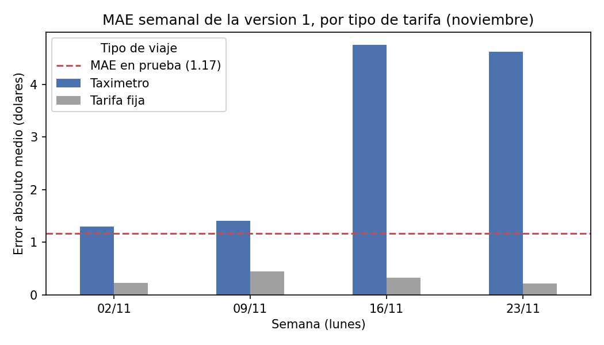
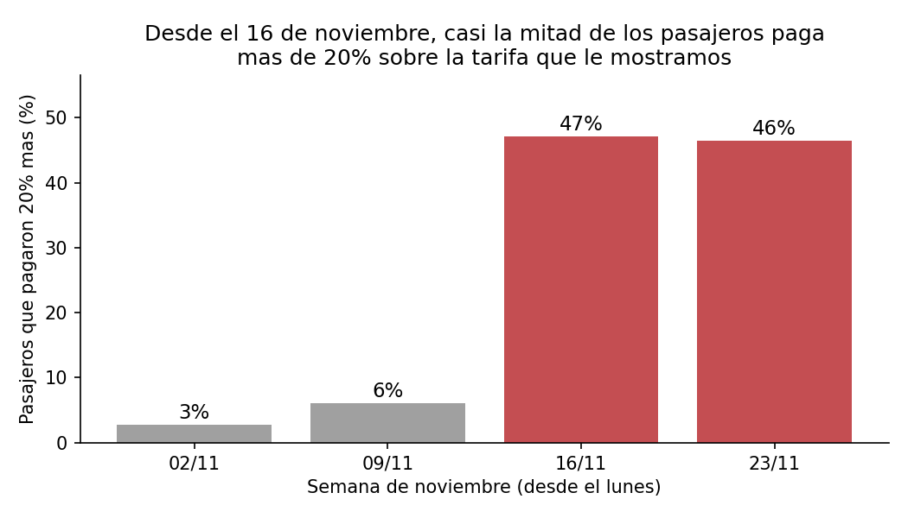

# Semana 14, Sesión 2: Comunicación técnica y ejecutiva de los resultados

> Objetivo de la sesión: adaptar la presentación de los resultados y limitaciones de tu proyecto a una audiencia técnica y a una audiencia ejecutiva.

**Lectura previa de esta sesión:** ["How to Effectively Communicate Results to Stakeholders As a Data Scientist"](https://medium.com/@sahin.samia/how-to-effectively-communicate-results-to-stakeholders-as-a-data-scientist-711e88dd464f), Sahin Samia.

**Referencia de esta sesión:** *Designing Machine Learning Systems*, Cap. 11: The Human Side of Machine Learning.

## Requisitos antes de esta sesión

Nada nuevo que instalar. Hoy se escribe más de lo que se programa: los dos scripts preparan los números y los gráficos, y el trabajo es decidir qué se dice a quién.

## Antes de empezar

A partir de la lectura previa:

**Según el artículo, ¿qué hay que saber de la audiencia antes de preparar la presentación? ¿Qué recomienda hacer con la jerga técnica?**

_(tu respuesta)_

**¿Qué lugar le da el artículo a las limitaciones y a la incertidumbre de los resultados?**

_(tu respuesta)_

## Pregunta de apertura

¿Qué cambia entre explicarle tu proyecto a otro científico de datos y a quien paga la factura? Escribe la primera oración que le dirías a cada uno.

_(la primera oración para un científico de datos)_

_(la primera oración para quien paga)_

## Ejercicio 1: noviembre, para dos audiencias

Carpeta: [`starter/ejercicio1/`](./starter/ejercicio1/). [`tarifas_noviembre.csv`](./starter/ejercicio1/tarifas_noviembre.csv) tiene los 1156 viajes de noviembre del monitoreo de la Semana 13: la tarifa estimada por la versión 1, la cobrada y si el viaje tenía tarifa fija. [`graficos_tarifa.py`](./starter/ejercicio1/graficos_tarifa.py) calcula el resumen por semana y dibuja dos gráficos con los mismos datos, `grafico_tecnico.png` y `grafico_ejecutivo.png`. Los 3 `TODO`: el resumen, el gráfico técnico y el gráfico ejecutivo.

```
python graficos_tarifa.py
```

**Respuesta 1 (TODO 1):** el MAE pasó de 1.18 a 4.29. Antes de calcularlo: ¿qué número de la tabla le dirías a la gerente de operaciones, que nunca oyó hablar del MAE?

El de **`pagan_20_mas`**: cuántos pasajeros pagaron más de 20 % por encima de la tarifa que les mostró la app. Habla de pasajeros y de la promesa que se les hizo, y se entiende sin saber qué es un error absoluto medio. El MAE dice "4.29 dólares de error promedio", que suena poco y mezcla los que pagan de más con los que pagan de menos. "Casi la mitad de los pasajeros paga más de 20 % de lo que le dijimos" es un problema de servicio al cliente que la gerente reconoce.

La tabla:

```
        viajes    mae  pagan_20_mas  diferencia
semana
02/11      291  1.179         0.027       0.159
09/11      318  1.340         0.060      -0.068
16/11      308  4.292         0.471       4.230
23/11      239  4.304         0.464       4.193
```

Pasó de **3 % y 6 % a 47 % y 46 %**. La diferencia también sirve: desde el 16, cada pasajero paga en promedio **4.2 dólares más** de lo estimado. En las dos últimas semanas fueron 2305 dólares de más en total.

**Respuesta 2 (TODO 2 y 3):** los dos gráficos usan los mismos viajes. Haz una lista de todo lo que cambia entre uno y otro: la métrica, el título, la cantidad de series, los colores.

| | Gráfico técnico | Gráfico ejecutivo |
|---|---|---|
| **Métrica** | MAE en dólares | % de pasajeros que pagó más de 20 % sobre lo estimado |
| **Título** | Describe qué se mide: "MAE semanal de la version 1, por tipo de tarifa (noviembre)" | Dice la conclusión: "Desde el 16 de noviembre, casi la mitad de los pasajeros paga más de 20 % sobre la tarifa que le mostramos" |
| **Series** | Dos (taxímetro y tarifa fija), barras agrupadas | Una sola |
| **Referencia** | Línea punteada con el MAE de prueba (1.17), con leyenda | Ninguna: el contraste lo dan las semanas grises |
| **Colores** | Azul y gris para distinguir los dos tipos de tarifa, rojo para la referencia | Gris en las semanas normales y rojo en las dos semanas del problema: el color marca el mensaje |
| **Valores** | Se leen en el eje Y | Escritos encima de cada barra (3 %, 6 %, 47 %, 46 %), sin necesidad de leer el eje |
| **Ejes** | Unidad técnica: "Error absoluto medio (dolares)" | Unidad de la gerente: "Pasajeros que pagaron 20% mas (%)", sin marco arriba ni a la derecha |
| **Lo que deja ver** | El por qué: el error sube solo en taxímetro (de 1.3 a 4.7) y no en tarifa fija (≈ 0.3), así que es un cambio en la tarifa por taxímetro | El qué y el cuánto: qué parte de los clientes está afectada y desde cuándo |

**Respuesta 3:** escribe las dos diapositivas. Cada una tiene un título que es una oración completa, el gráfico y como máximo cuatro líneas.

**Diapositiva técnica** (para el equipo de datos):

**Título:** Desde el 16 de noviembre, el MAE de la versión 1 se triplicó solo en los viajes con taxímetro: es deriva conceptual, no de datos.



- Medido: MAE semanal sobre 1156 viajes de noviembre, uniendo cada predicción con la tarifa cobrada por `id_prediccion`.
- El MAE pasa de 1.18 y 1.34 a 4.29 y 4.30 (prueba: 1.17). En taxímetro sube de 1.3 a 4.7; en tarifa fija queda en ≈ 0.3.
- Los viajes son los mismos (PSI de distancia y zona ≤ 0.072, bajo el máximo normal de 0.12); cobrada ÷ estimada pasa de 1.00 a 1.20: hubo un aumento de 20 % en el taxímetro.
- Limitación: dos semanas de datos después del cambio, y el sesgo solo se ve con la tarifa cobrada, que llega al terminar el viaje.

**Diapositiva ejecutiva** (para la gerente de operaciones):

**Título:** Desde el 16 de noviembre, casi la mitad de los pasajeros paga más de 20 % sobre la tarifa que le mostramos.



- Qué pasó: desde el 16, la ciudad cobra más por taxímetro y la app sigue mostrando las tarifas de antes.
- Qué cuesta: cada pasajero paga en promedio 4.2 dólares más de lo prometido, 2305 dólares en dos semanas, y los reclamos y la confianza van detrás.
- Qué recomendamos: actualizar el modelo con los viajes posteriores al 16 de noviembre esta semana, y mientras tanto subir 20 % las tarifas con taxímetro que muestra la app.
- Qué necesitamos: su aprobación para el ajuste provisional, y que operaciones nos avise el día en que cambie una tarifa oficial.

## Durante el ConcepTest

**Tu voto, antes de discutir en pareja** (A, B, C o D):

_(tu voto)_

**Tu razonamiento:**

_(tu respuesta)_

**Después de discutir en pareja, ¿cambiaste de voto? ¿Por qué?**

_(tu respuesta)_

## Ejercicio 2: el fraude, en dólares

Solo o en pareja. Carpeta: [`starter/ejercicio2/`](./starter/ejercicio2/). El reporte técnico de la Semana 13 decía que el recall de la semana del 16 cayó de 0.74 a 0.28. [`costos_fraude.py`](./starter/ejercicio2/costos_fraude.py) lo traduce a dólares con los costos de la Semana 11 (40 por fraude no detectado, 3 por revisar un pago legítimo). Los pasos 1 a 3 tienen `TODO`: los errores por semana, su costo y el costo de una semana normal. Los pasos 4 (la oración para la gerencia) y 5 (lo que cuesta un mes así) solo tienen un comentario. Resuelve y corre `python comprobar.py` hasta que los cinco pasos digan `OK`; después, `python costos_fraude.py`.

**Respuesta 1:** ¿qué oración te dio el paso 4? ¿Qué le falta para que la gerente pueda decidir algo?

```
La semana del 2026-11-16, el fraude que no detectamos y las revisiones costaron 2359 dolares, 2.7 veces una semana normal.
```

Dice qué pasó y cuánto costó, pero **no le deja nada que decidir**. Le falta:
- **La causa**, en una frase: el modelo deja pasar más fraudes (detectó 21 de 76, contra unos 3 de cada 4 antes).
- **Qué está en juego si no se hace nada:** un mes así son **5968 dólares más** que uno normal.
- **Qué se recomienda:** reentrenar con los pagos recientes y, mientras tanto, bajar el umbral para mandar más pagos a revisión.
- **Qué se necesita de ella:** aprobar más revisiones manuales mientras tanto.
- **Que el dato es de hace un mes:** la semana del 16 recién se pudo medir el 13 de diciembre, porque los fraudes tardan hasta 21 días en confirmarse.

(`comprobar.py`: los 5 pasos `OK`. La tabla: 827, 907 y 2359 dólares por semana; una semana normal cuesta 867.)

**Respuesta 2:** escribe el mensaje ejecutivo completo, en cinco oraciones como máximo: qué pasó, cuánto cuesta, qué recomiendan, qué necesitan y qué riesgo queda.

Desde la semana del 16 de noviembre, el sistema de fraude dejó pasar casi 3 de cada 4 fraudes, cuando antes dejaba pasar 1 de cada 4. Esa semana el fraude no detectado y las revisiones costaron 2359 dólares, 2.7 veces una semana normal, y un mes así cuesta unos 6000 dólares más. Recomendamos actualizar el modelo con los pagos de noviembre y, hasta tenerlo, enviar más pagos a revisión manual. Para eso necesitamos que apruebe unas horas extra del equipo de revisión durante dos semanas. El riesgo que queda es que nos enteramos tarde: los fraudes se confirman hasta 21 días después, así que lo que pase hoy lo sabremos a mediados de enero.

**Respuesta 3:** el costo de 40 dólares por fraude no detectado es una suposición de la Semana 11. ¿Dónde lo dirías, en el mensaje ejecutivo o en el técnico? ¿Qué pasa con tu recomendación si el costo real fuera la mitad?

En los dos, pero distinto. En el **técnico**, explícito y con el análisis de sensibilidad: "costo por fraude no detectado: 40 dólares, supuesto de la Semana 11; con 20, la semana del 16 cuesta 1259 y un mes así, 3008 más". En el **ejecutivo**, como una sola frase que dice que el número depende de un supuesto: "con lo que estimamos que cuesta cada fraude". La gerente no necesita el 40, pero sí saber que el monto en dólares es una estimación y que alguien de finanzas podría corregirla.

Con 20 dólares, **la recomendación no cambia**. La semana del 16 cuesta 1259 dólares, **2.5 veces** una semana normal (507), contra 2.7 veces con 40: la proporción casi no se mueve, porque el cambio viene de los fraudes no detectados (55 contra 17 y 19), no del precio. Un mes así cuesta **3008 dólares más** en lugar de 5968: sigue valiendo la pena reentrenar. Lo que sí cambia es el **umbral**: con un fraude más barato, revisar un pago legítimo (3 dólares) pesa más, y conviene recalcular el umbral de 0.10 con el costo nuevo antes de mandar más pagos a revisión.

## Ejercicio 3: los resultados de tu proyecto, dos veces

Usa tu proyecto en [`psets/proyecto/`](../../psets/README.md). Esta vez no hay plantilla.

### Entregable 1: `docs/resultados_tecnico.pdf`

Una diapositiva para otra persona del equipo de datos: el modelo y la línea base, la métrica de la Semana 11 con su esquema de validación, lo que mostró el monitoreo y las limitaciones, con los números.

### Entregable 2: `docs/resultados_ejecutivo.pdf`

La misma diapositiva para quien decide si se usa el modelo: un título que dice la conclusión, el resultado en la unidad de quien decide (dinero, tiempo, casos), qué recomiendan, qué necesitan y qué no hace el modelo. Sin el nombre del algoritmo ni de la métrica.

Puedes armar las dos diapositivas en lo que prefieras (Google Slides, PowerPoint, Markdown exportado) y guardarlas en PDF.

**¿Qué número de tu proyecto usaste en la versión ejecutiva que no aparece en la técnica? ¿De dónde salió?**

**441 emergencias menos por semana sin recurso previsto**, y **1465 asignaciones menos que sobran**, sobre unas 62 533 emergencias por semana en los 222 cantones. Salieron de `docs/generar_resultados.py`, que genera las dos diapositivas:

1. Toma las 52 semanas completas del período de prueba (agosto de 2025 a agosto de 2026).
2. Para cada cantón y día, compara las emergencias reales con lo que habría planificado el modelo (versión 2) y con lo que se planifica hoy (las emergencias del día, la línea base "igual que hoy").
3. Una emergencia sin recurso previsto es cada emergencia por encima de lo planificado. Una asignación que sobra, cada una por debajo.
4. Por semana suman 4831 faltantes con el modelo contra 5272 con la línea base, y 3797 sobrantes contra 5262.

Es el mismo error que mide el costo asimétrico de la versión técnica (11.77 contra 13.56), pero sumado en la unidad de quien planifica (emergencias y asignaciones) en lugar de promediado por cantón y día.

Las diapositivas están en `docs/resultados_tecnico.pdf` y `docs/resultados_ejecutivo.pdf`.

**¿Qué limitación dejaste en las dos versiones, y cómo la dijiste en cada una?**

Dos.

**1. El modelo no ve a tiempo un cambio en la relación entre la historia y el futuro (la deriva conceptual).**
- **Técnica:** "La deriva conceptual no mueve el PSI: solo la ve el MAE, 7 días tarde", junto al número de la Semana 14: con 25 % más registros el costo casi se triplica y el PSI queda igual.
- **Ejecutiva:** "Si cambia cómo se registran las emergencias, nos enteramos una semana después". Sin PSI, sin MAE y sin "deriva": qué tipo de cambio, y cuánto tarda en saberse.

**2. El error se concentra en las ciudades grandes.**
- **Técnica:** "Quito y Guayaquil concentran el 24 % del error absoluto".
- **Ejecutiva:** "En Quito y Guayaquil se equivoca más: dejar un margen". El porcentaje se cambia por lo que la persona tiene que hacer.

La versión técnica dice la limitación con el número que la mide. La ejecutiva, con la consecuencia y la acción.

## Antes de la próxima sesión

**Lectura:** ["AI Model Lifecycle Management: From Development to Decommissioning"](https://blog.cognitiveview.com/ai-model-lifecycle-management-from-development-to-decommissioning/), CognitiveView.

Hoy escribiste "qué no hace el modelo" en una diapositiva. Ahora imagina que sí lo hace mal: ¿bajo qué condición apagarías el modelo de tu proyecto, y quién tendría que enterarse?

_(tu respuesta)_
